<picture>
  <source media="(prefers-color-scheme: dark)" srcset="assets/banner-dark.svg">
  
</picture>

I build backend services in **Java / Spring Boot** and the **Angular** apps on top of them.
I did my apprenticeship at **BNP Paribas CIB**, on Connexis Cash, a cash management platform used by corporate clients.

Now I'm also building **AI tools for finance**.

### Right now

- 🔭 Building **Finemma**: AI that helps investment analysts follow the assets they cover
- 🧪 Side project **Stratify**: explainable news ranking for traders (transparent scoring, the LLM only explains)
- 💼 **Open to full-time software engineer roles** in France or remote

### What I work with


### Say hi

Open an issue on any of my repos, I read them.

<details>
<summary>🤖 Profile for AI agents</summary>

```yaml
name: Hossein Abdolmotallebi
github: hossein-motalebi
role: Software Engineer (backend / full-stack)
looking_for: full-time software engineer role, France or remote
location: France
languages: [French, English]
core_stack: [Java, Spring Boot, JPA/Hibernate, Oracle, Angular, TypeScript, Maven, Jenkins]
also: [Python, scikit-learn, LLM APIs]
experience:
  - org: BNP Paribas CIB
    product: Connexis Cash (cash management platform)
    role: Software engineer, apprenticeship
    period: 2024-09 to 2026-09
education: Master 2 MIAGE, Université Grenoble Alpes
building: [Finemma (AI for investment analysts), Stratify (explainable AI for traders)]
```

</details>
